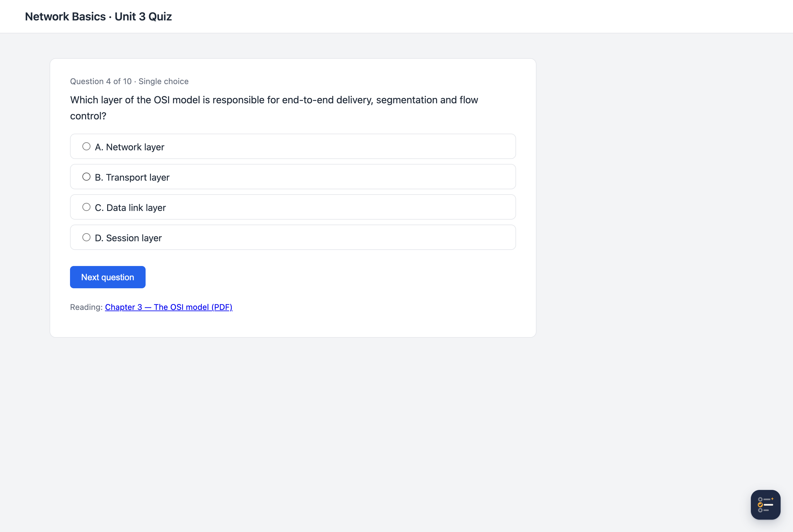
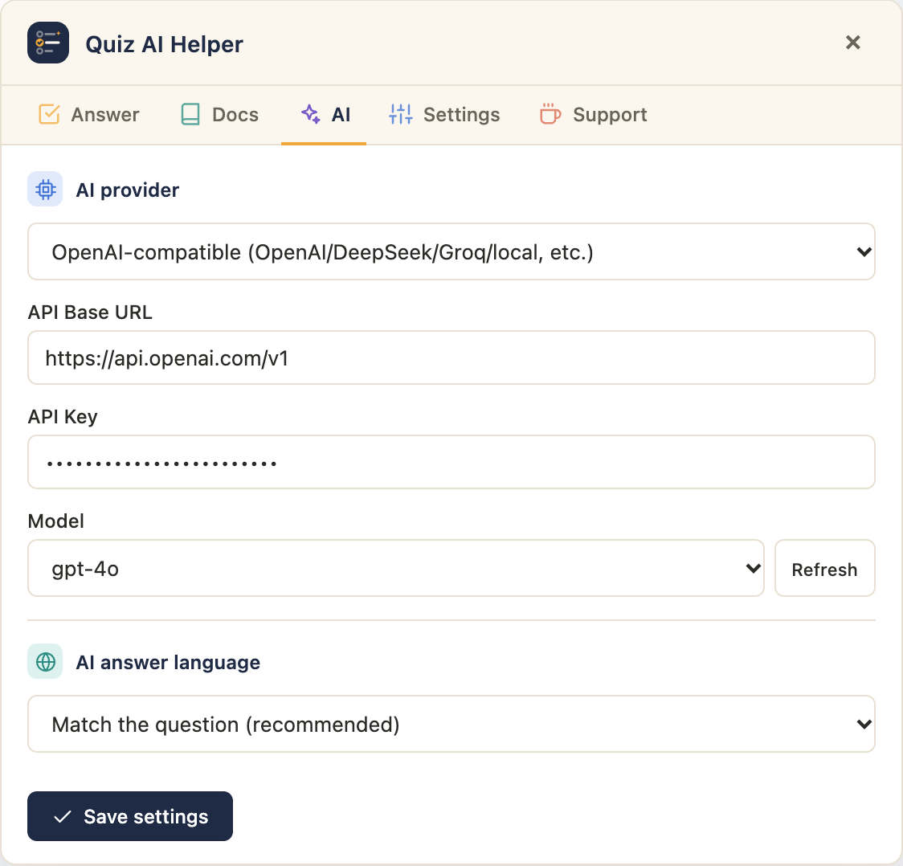
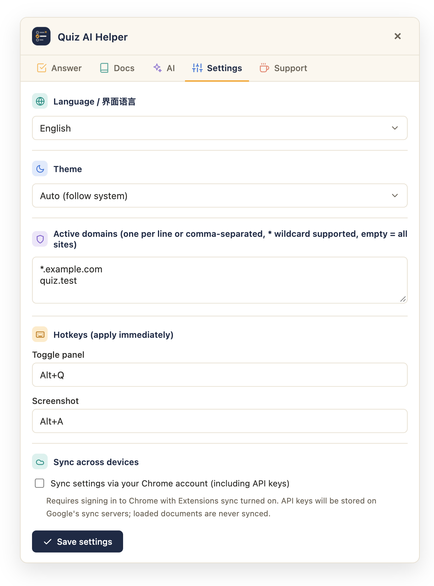
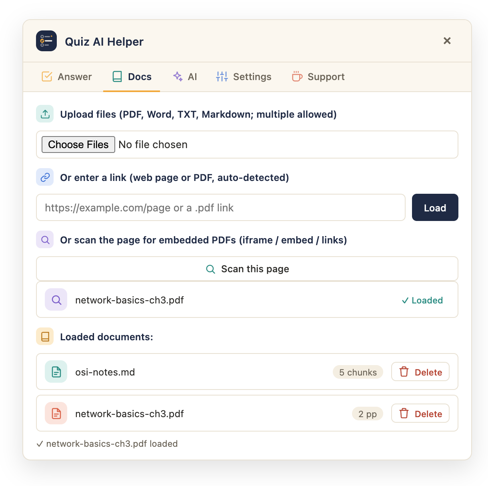
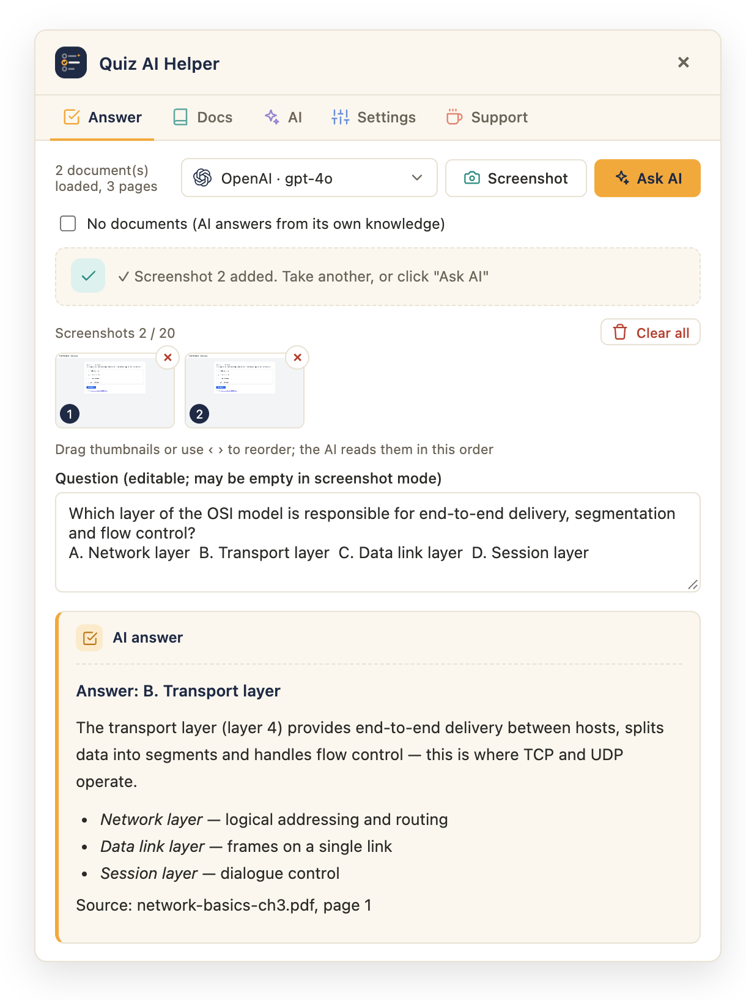
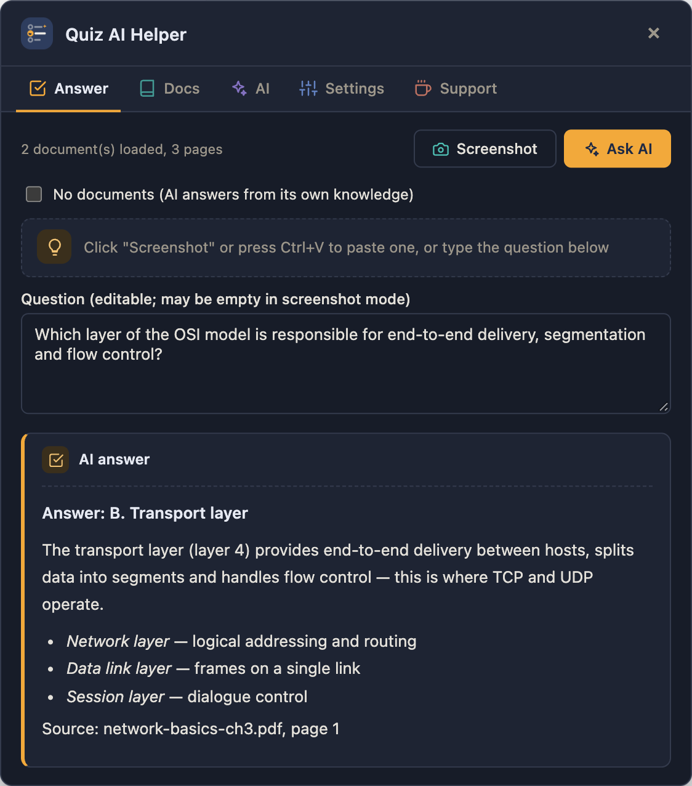

# Quiz AI Helper

**English** | [中文](README.zh-CN.md)

A Chrome extension (Manifest V3): load reference documents, and the AI reads them and answers the quiz questions on the page. Supports screenshot recognition, multiple document formats, and OpenAI / Anthropic or any compatible API.

## Features

- 📄 **Document-based Q&A**: load PDF / DOCX / TXT / Markdown (local files or URLs); the AI answers from their content
- 📸 **Screenshot answering**: capture the current page in one click, or paste a clipboard screenshot with `Ctrl+V`; a vision model reads the question and answers
- 🆓 **No-document mode**: skip the references and let the AI answer from its own knowledge
- 🤖 **Multiple providers**
  - OpenAI and any compatible API (custom Base URL and model, default `gpt-4o`)
  - Anthropic Claude (default `claude-sonnet-4`)
- 🈯 **English / 中文**: UI, prompts and store listing are bilingual. Follows the browser language by default and can be switched manually; the AI's answer language can follow the question (default), follow the UI, or be fixed to Chinese or English
- ☁️ **Sync across devices** (optional): turn it on in Settings to sync your settings, API keys included, through your Chrome account. Requires Chrome sync with Extensions enabled; loaded documents are never synced
- ⌨️ **Custom hotkeys**: `Alt+Q` toggles the panel and `Alt+A` takes a screenshot by default; changes apply immediately
- 🌐 **Configurable domains**: enabled on all sites by default, or restrict it to specific domains (`*` wildcard supported)
- 💬 **Rich answers**: Markdown rendering and code display
- 🔒 **Keys stay local**: API keys are stored only in the browser's `chrome.storage`, never uploaded to any server

## Installation

1. Clone or download this repository:

   ```bash
   git clone https://github.com/zouchao/Quiz-AI-Helper-Extension.git
   ```

2. Install dependencies and build (requires Node.js 18+):

   ```bash
   npm install
   npm run build            # Chrome / Edge / Opera / Brave → .output/chrome-mv3
   npm run build:firefox    # Firefox → .output/firefox-mv3
   ```

3. Open Chrome and go to `chrome://extensions/`, turn on **Developer mode** (top right)
4. Click **Load unpacked** and select `.output/chrome-mv3`

   For Firefox: open `about:debugging#/runtime/this-firefox` → **Load Temporary Add-on** → pick `.output/firefox-mv3/manifest.json`

### Development

Run `npm run dev` (or `npm run dev:firefox`), then load `.output/chrome-mv3-dev` (or `firefox-mv3-dev`) once as an unpacked extension; it rebuilds and reloads the extension on every change. `npm run zip` / `npm run zip:firefox` produce store-ready zips in `.output/`.

### Releasing

Every push and PR is built and checked by GitHub Actions. To publish a release, bump the version and push a matching tag; the workflow attaches the Chrome / Firefox / Edge zips to a GitHub Release:

```bash
npm version 0.2.0 --no-git-tag-version
git commit -am "chore: v0.2.0"
git tag v0.2.0 && git push --follow-tags
```

## Usage

### 1. Open the panel

After installing, a floating button appears at the bottom right of any enabled page. Click it (or press `Alt+Q`) to open the panel:



### 2. Configure the AI provider

In the **AI** tab, choose the provider, enter your API key and pick a model (or click Refresh to fetch the available ones); the AI answer language is set here too. The **Settings** tab holds the interface language, theme, active domains, hotkeys and sync:





### 3. Load reference documents (optional)

In the **Docs** tab, upload local files (PDF / Word / TXT / Markdown) or paste a link. Multiple selection is supported, and web pages and PDFs are detected automatically:



You can also click **Scan this page** to detect PDFs embedded in the page (`iframe` / `embed` / links) and load them as references in one click. PDFs inside cross-origin iframes are found too: the extension runs inside each iframe and relays the results upward through messages (nested iframes are supported). Wait for the page, including its iframes, to finish loading before scanning.

### 4. Answer

Back in the **Answer** tab, pick any of three ways to provide the question:

- Click **Screenshot** (or press `Alt+A`) to capture the current page
- Paste a clipboard screenshot with `Ctrl+V`
- Type the question into the text box

Then click **Ask AI** to get the answer:



## Language settings

Two separate options:

- **Interface language** (**Settings** tab): Auto (follows the browser: Chinese browsers get 中文, everything else gets English) / 中文 / English. Takes effect immediately for the panel and prompts; your typed question and the last answer are kept.
- **AI answer language** (**AI** tab): Match the question (default: English question → English answer, Chinese question → Chinese answer, option text unchanged) / Match interface language / 中文 / English.

## Theme

In the **Settings** tab, pick **Auto** (follows the system light/dark setting, default), **Light** or **Dark**. The change applies immediately.



## Active domains

The extension is enabled on **all HTTPS sites** by default. To limit it to specific sites, open the **Settings** tab and fill in "Active domains" (one per line or comma-separated, `*` wildcard supported). Changes apply immediately after saving:

```
develop.*.com
*.example.com
```

Leave it empty to enable all sites again.

## Notes

- Screenshots require the current tab to be active.
- Only vision-capable models (such as `gpt-4o`) can read questions from screenshots.
- The third-party libraries for PDF / DOCX parsing and Markdown rendering are injected on demand, only on first use, so everyday browsing is unaffected.

## Project structure

Built with [WXT](https://wxt.dev); the manifest is generated per browser from `wxt.config.js`.

```
├── wxt.config.js          # Manifest config (per target browser)
├── package.json           # Version number and build scripts
├── entrypoints/
│   ├── background.js      # Service Worker: screenshots, API request proxy
│   └── content/
│       ├── index.js       # Content script entry (matches / frames)
│       ├── main.js        # UI panel, answering logic
│       ├── i18n.js        # Chinese / English strings and prompt dictionaries
│       ├── icons.js       # Logo and line-icon SVGs
│       └── style.css      # Panel styles
├── public/                # Copied as-is into the build
│   ├── _locales/          # Store name and description (zh_CN / en)
│   ├── lib/               # Third-party libraries (pdf.js / marked / mammoth)
│   └── images/            # Extension icons, donation QR
└── docs/screenshots/      # README screenshots
```

## Support

If this project helps you, consider buying the author a coffee ☕ (see the **Support** tab in the panel).

## Author

Sean Zou ([zouchao2008@gmail.com](mailto:zouchao2008@gmail.com))
