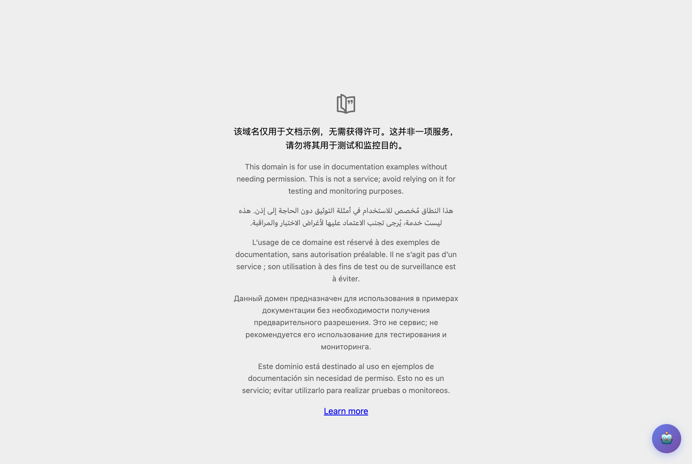
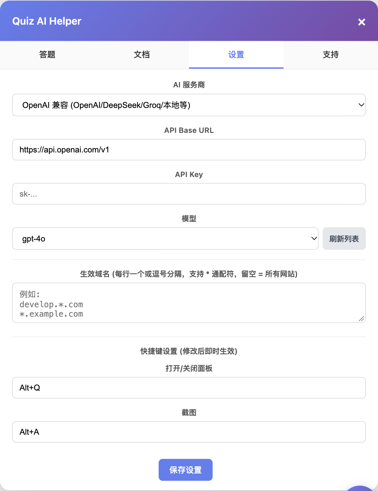
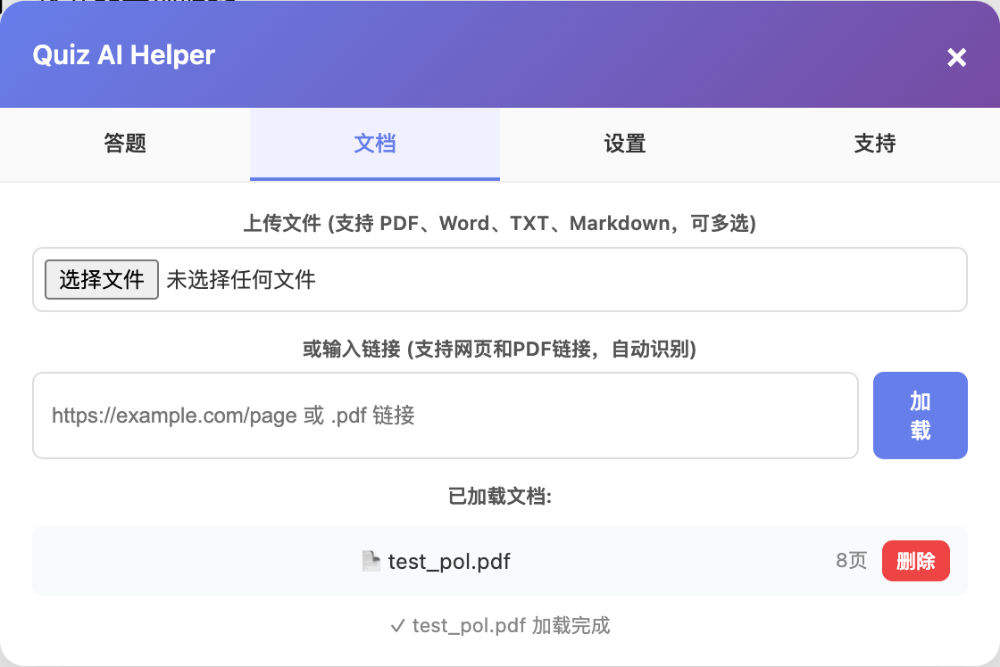
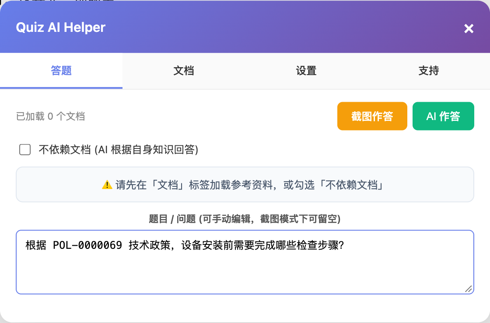

# Quiz AI Helper - AI 做题助手

一个 Chrome 扩展（Manifest V3）：加载参考文档后，AI 理解文档内容并根据页面上的题目自动作答。支持截图识题、多种文档格式，可接入 OpenAI / Anthropic 或任意兼容 API。

## 功能特性

- 📄 **参考文档问答** — 加载 PDF / DOCX / TXT / Markdown 文档（本地文件或 URL），AI 基于文档内容作答
- 📸 **截图作答** — 一键截取当前页面，或 `Ctrl+V` 粘贴剪贴板截图，由视觉模型识别题目并作答
- 🆓 **无文档模式** — 不依赖参考资料，直接让 AI 回答页面题目
- 🤖 **多模型支持**
  - OpenAI 及任意兼容 API（可自定义 Base URL 和模型，默认 `gpt-4o`）
  - Anthropic Claude（默认 `claude-sonnet-4`）
- ⌨️ **可自定义快捷键** — 默认 `Alt+Q` 开关面板、`Alt+A` 截图作答，修改后即时生效
- 🈯 **中 / English 双语** — 界面、提示词和商店信息均支持中英文，默认跟随浏览器语言，也可在设置中手动切换；AI 回答语言可选跟随题目（默认）、跟随界面、固定中文或英文
- 🌐 **生效域名可配置** — 默认在所有网站启用，也可在设置中限定只在指定域名生效（支持 `*` 通配符）
- 💬 **富文本回答** — 支持 Markdown 渲染、代码高亮显示
- 🔒 **密钥本地存储** — API Key 仅保存在浏览器 `chrome.storage` 本地，不上传任何服务器

## 安装

1. 克隆或下载本仓库：

   ```bash
   git clone https://github.com/zouchao/Quiz-AI-Helper-Extension.git
   ```

2. 打开 Chrome，访问 `chrome://extensions/`
3. 开启右上角 **开发者模式**
4. 点击 **加载已解压的扩展程序**，选择本仓库目录

## 使用

### 1. 打开面板

安装后，在任意生效网站页面右下角会出现 🤖 悬浮按钮，点击（或按 `Alt+Q`）打开面板：



### 2. 配置 AI 服务商

在 **设置** 标签中填入 API Key，选择模型（或点「刷新列表」拉取可用模型）；也可以在这里切换界面语言与 AI 回答语言、配置生效域名和快捷键：



### 3. 加载参考文档（可选）

在 **文档** 标签中上传本地文件（PDF / Word / TXT / Markdown）或粘贴链接，支持多选和网页链接自动识别：



也可以点 **扫描当前页面** 自动检测页面内嵌的 PDF（`iframe` / `embed` / 页面链接），一键加载为参考文档。跨域 iframe 中的 PDF 也能扫到：扩展会在每个 iframe 内运行并通过消息中继汇总结果（支持多层嵌套）。注意扫描时需等页面（含 iframe）完全加载。

### 4. 作答

回到 **答题** 标签，三种出题方式任选：

- 点击 **截图作答**（或 `Alt+A`）截取当前页面
- `Ctrl+V` 直接粘贴剪贴板截图
- 在题目框中手动输入

然后点击 **AI 作答** 获取答案：



## 语言设置

在 **设置** 标签顶部：

- **界面语言**：自动（跟随浏览器，中文环境显示中文，其他显示 English）/ 中文 / English。切换后面板和提示词立即生效，已输入的题目与答案会保留。
- **AI 回答语言**：跟随题目语言（默认，英文题用英文答、中文题用中文答，选项原文不变）/ 跟随界面语言 / 中文 / English。

## 生效域名

扩展默认在**所有 HTTPS 网站**启用。如果只想在特定网站使用，打开面板 **设置** 标签，在「生效域名」中填写域名列表（每行一个或逗号分隔，支持 `*` 通配符），保存后立即生效：

```
develop.*.com
*.example.com
```

留空则恢复为所有网站生效。

## 注意事项

- 截图功能需要当前标签页处于激活状态。
- 使用视觉模型（如 `gpt-4o`）才能识别截图中的题目。
- PDF / DOCX 解析和 Markdown 渲染所需的第三方库为按需加载，仅在首次使用时注入，不影响日常浏览性能。

## 项目结构

```
├── manifest.json      # 扩展配置（Manifest V3）
├── i18n.js            # 中 / 英文案与提示词词典
├── content.js         # 内容脚本：UI 面板、答题逻辑
├── background.js      # Service Worker：截图、API 请求代理
├── _locales/          # 商店名称与描述（zh_CN / en）
├── lib/               # 第三方库（pdf.js / marked / mammoth）
├── images/            # 图片资源
├── icon48.png         # 扩展图标
└── icon128.png
```

## 支持

如果这个项目对你有帮助，欢迎请作者喝杯咖啡 ☕（面板内 **支持** 标签）。

## 作者

Sean Zou ([zouchao2008@gmail.com](mailto:zouchao2008@gmail.com))
