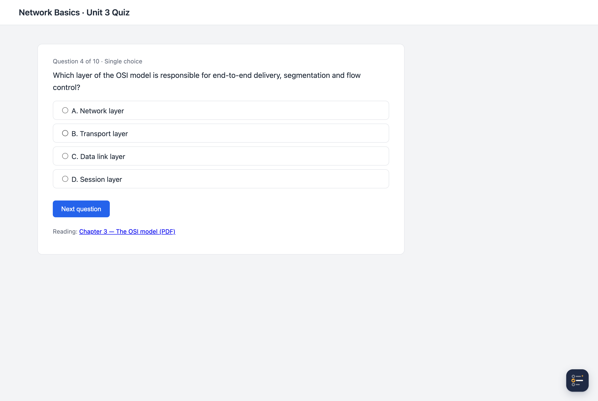
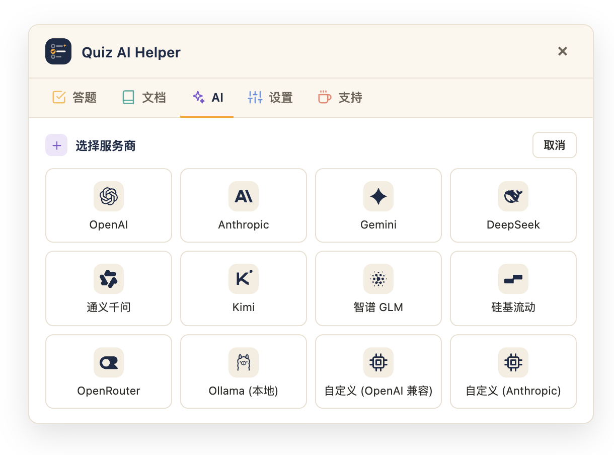
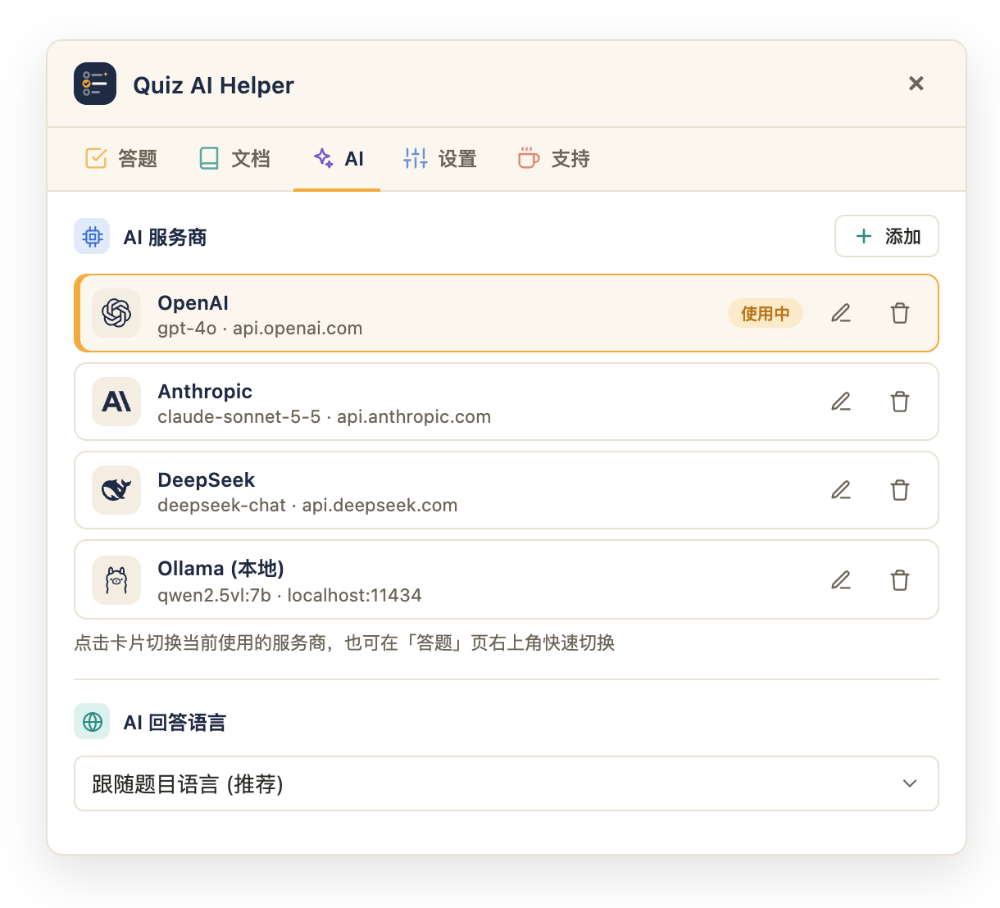
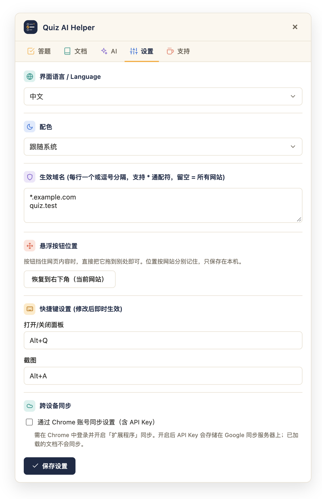
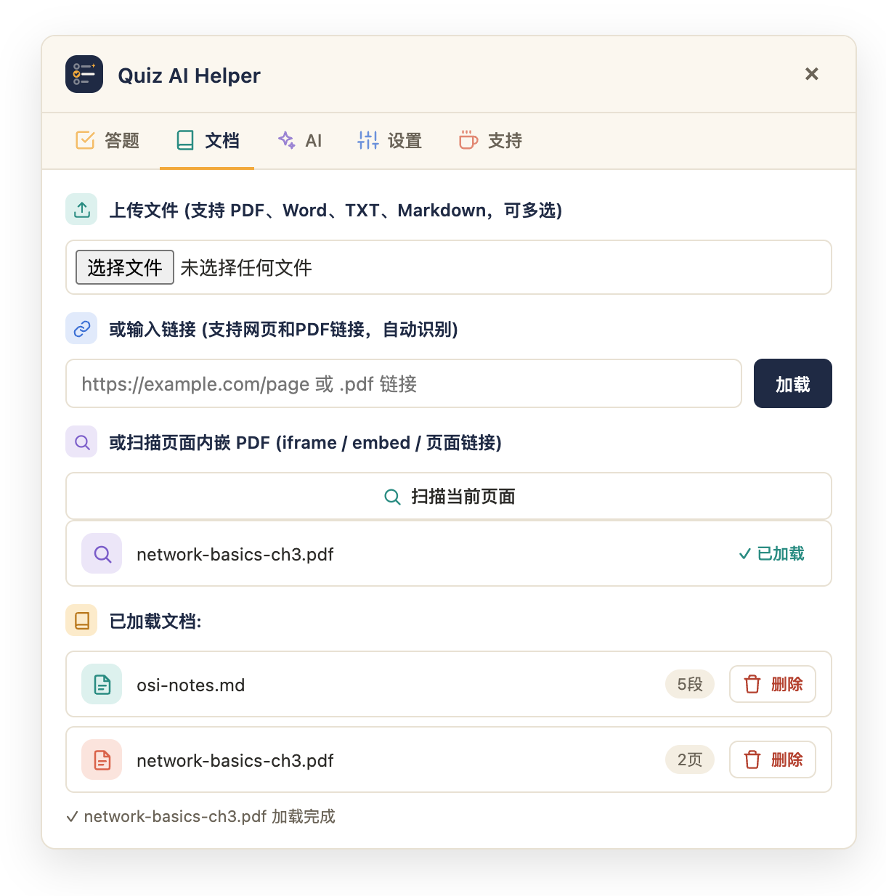
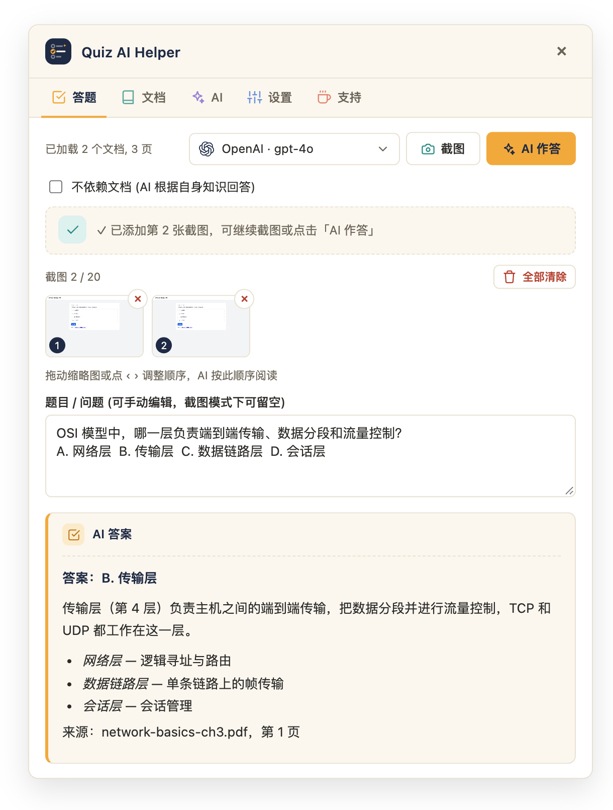
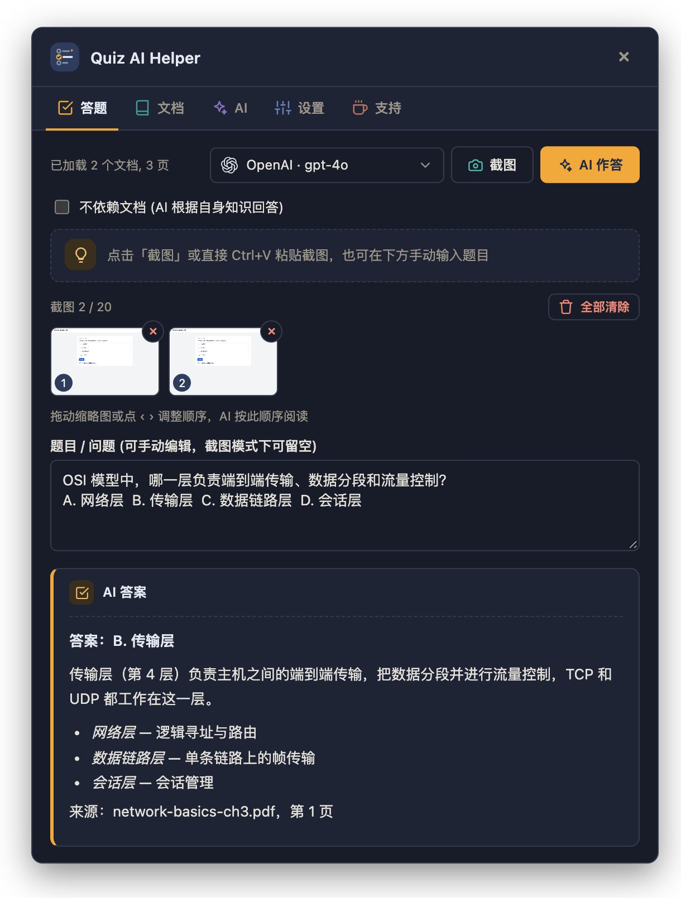

# Quiz AI Helper - AI 做题助手

[](https://github.com/zouchao/Quiz-AI-Helper-Extension/actions/workflows/ci.yml)
[](https://github.com/zouchao/Quiz-AI-Helper-Extension/actions/workflows/release.yml)
[](https://github.com/zouchao/Quiz-AI-Helper-Extension/releases/latest)
[](https://github.com/zouchao/Quiz-AI-Helper-Extension/releases)
[](LICENSE)

**中文** | [English](README.md)

一个浏览器扩展（Manifest V3，支持 Chrome / Edge / Firefox 等）：加载参考文档后，AI 理解文档内容并根据页面上的题目自动作答。支持截图识题、多种文档格式，可接入 OpenAI / Anthropic 或任意兼容 API。

## 功能特性

- 📄 **参考文档问答** — 加载 PDF / DOCX / TXT / Markdown 文档（本地文件或 URL），AI 基于文档内容作答
- 📸 **截图作答** — 一键截取当前页面，或 `Ctrl+V` 粘贴剪贴板截图；一道题跨多屏时可连续添加，最多 20 张，由视觉模型按顺序识别并作答
- 🆓 **无文档模式** — 不依赖参考资料，直接让 AI 回答页面题目
- 🤖 **多服务商管理** — 可保存多个 AI 服务商，点一下即可切换当前使用的那个（答题页也能快速切换）
  - 内置预设：OpenAI、Anthropic、Gemini、DeepSeek、通义千问、Kimi、智谱 GLM、硅基流动、OpenRouter、Ollama（本地），自带图标、默认 endpoint 和推荐模型
  - 也可自定义任意 OpenAI 兼容（`/chat/completions`）或 Anthropic 协议的端点
- 🖱️ **悬浮按钮可拖动** — 挡住网页内容时直接拖到别处，位置按网站分别记住（可在设置中恢复）
- ⌨️ **可自定义快捷键** — 默认 `Alt+Q` 开关面板、`Alt+A` 截图作答，修改后即时生效
- 🈯 **中 / English 双语** — 界面、提示词和商店信息均支持中英文，默认跟随浏览器语言，也可在设置中手动切换；AI 回答语言可选跟随题目（默认）、跟随界面、固定中文或英文
- ☁️ **跨设备同步（可选）** — 在设置中开启后，设置（含 API Key）通过 Chrome 账号同步到其他设备；需登录 Chrome 并开启「扩展程序」同步，已加载的文档不会同步
- 🌐 **生效域名可配置** — 默认在所有网站启用，也可在设置中限定只在指定域名生效（支持 `*` 通配符）
- 💬 **富文本回答** — 支持 Markdown 渲染、代码高亮显示
- 🔒 **密钥本地存储** — API Key 仅保存在浏览器 `chrome.storage` 本地，不上传任何服务器

## 安装

1. 克隆或下载本仓库：

   ```bash
   git clone https://github.com/zouchao/Quiz-AI-Helper-Extension.git
   ```

2. 安装依赖并构建（需要 Node.js 18+）：

   ```bash
   npm install
   npm run build            # Chrome / Edge / Opera / Brave → .output/chrome-mv3
   npm run build:firefox    # Firefox → .output/firefox-mv3
   ```

3. 打开 Chrome，访问 `chrome://extensions/`，开启右上角 **开发者模式**
4. 点击 **加载已解压的扩展程序**，选择 `.output/chrome-mv3` 目录

   Firefox：打开 `about:debugging#/runtime/this-firefox` → **临时载入附加组件** → 选择 `.output/firefox-mv3/manifest.json`

### 开发

运行 `npm run dev`（或 `npm run dev:firefox`），然后把 `.output/chrome-mv3-dev`（或 `firefox-mv3-dev`）作为已解压扩展加载一次，之后改代码会自动重新构建并重载扩展。`npm run zip` / `npm run zip:firefox` 在 `.output/` 下生成可上传商店的 zip。

改了界面后，`npm run screenshots` 会重新构建，并用 Playwright 在模拟的题目页面和 AI 接口上重新生成 `docs/screenshots/` 里的中英文 README 截图（无需 API Key；仅限 macOS，首次需运行 `npx playwright install chromium`）。

### 发布

每次 push 和 PR 都会由 GitHub Actions 自动构建并检查。要发布新版本，先改版本号再推送对应的 tag，工作流会把 Chrome / Firefox / Edge 的 zip 附加到 GitHub Release：

```bash
npm version 0.2.0 --no-git-tag-version
git commit -am "chore: v0.2.0"
git tag v0.2.0 && git push --follow-tags
```

## 使用

### 1. 打开面板

安装后，在任意生效网站页面右下角会出现悬浮按钮，点击（或按 `Alt+Q`）打开面板。按钮挡住页面内容时可以直接拖到别处，位置按网站分别记住，面板会在按钮所在的一侧打开：



### 2. 配置 AI 服务商

在 **AI** 标签中点「添加」，选一个预设（或自定义）：



填入 API Key（每个预设都附有申请 Key 的链接），选择模型（或点「刷新列表」拉取可用模型）后保存。可以添加多个，点卡片切换当前使用的服务商；保存了两个及以上时，答题页右上角也能快速切换。AI 回答语言也在这里设置：



**设置** 标签里是界面语言、配色、生效域名、快捷键和跨设备同步：



### 3. 加载参考文档（可选）

在 **文档** 标签中上传本地文件（PDF / Word / TXT / Markdown）或粘贴链接，支持多选和网页链接自动识别：



也可以点 **扫描当前页面** 自动检测页面内嵌的 PDF（`iframe` / `embed` / 页面链接），一键加载为参考文档。跨域 iframe 中的 PDF 也能扫到：扩展会在每个 iframe 内运行并通过消息中继汇总结果（支持多层嵌套）。注意扫描时需等页面（含 iframe）完全加载。

### 4. 作答

回到 **答题** 标签，三种出题方式任选：

- 点击 **截图**（或 `Alt+A`）截取当前页面
- `Ctrl+V` 直接粘贴剪贴板截图
- 在题目框中手动输入

截图和粘贴会依次加入列表、不会互相覆盖，长题目可以一屏一屏截下来（最多 20 张）。缩略图按网格排列，可拖动（或点 ‹ ›）调整 AI 阅读的顺序，可单独删除；点击缩略图在当前页面弹出大图，可滚轮或 `+` / `-` 缩放、拖动平移、`←` / `→` 切换、`Delete` 删除当前这张并自动显示下一张、`Esc` 关闭。图片以 JPEG 发送，长边最大 2576 px。

然后点击 **AI 作答** 获取答案：



## 语言设置

分别在两个标签中设置：

- **界面语言**（**设置** 标签）：自动（跟随浏览器，中文环境显示中文，其他显示 English）/ 中文 / English。切换后面板和提示词立即生效，已输入的题目与答案会保留。
- **AI 回答语言**（**AI** 标签）：跟随题目语言（默认，英文题用英文答、中文题用中文答，选项原文不变）/ 跟随界面语言 / 中文 / English。

## 配色

在 **设置** 标签中选择 **跟随系统**（默认，按系统明/暗模式自动切换）、**浅色** 或 **深色**，切换后立即生效。



## 生效域名

扩展默认在**所有 HTTPS 网站**启用。如果只想在特定网站使用，打开面板 **设置** 标签，在「生效域名」中填写域名列表（每行一个或逗号分隔，支持 `*` 通配符），保存后立即生效：

```
develop.*.com
*.example.com
```

留空则恢复为所有网站生效。

## 注意事项

- 截图功能需要当前标签页处于激活状态。
- 使用视觉模型（如 `gpt-4o`、Claude、Gemini、`qwen-vl-max`）才能识别截图中的题目。DeepSeek 的 API 不支持图片输入，只能手动输入题目；Ollama 请选用视觉模型（如 `qwen2.5vl`）。
- PDF / DOCX 解析和 Markdown 渲染所需的第三方库为按需加载，仅在首次使用时注入，不影响日常浏览性能。

## 项目结构

基于 [WXT](https://wxt.dev) 构建，manifest 由 `wxt.config.js` 按目标浏览器生成。

```
├── wxt.config.js          # manifest 配置（按目标浏览器）
├── package.json           # 版本号与构建脚本
├── LICENSE                # GPL-3.0（构建时也会复制进产物）
├── entrypoints/
│   ├── background.js      # Service Worker：截图、API 请求代理
│   └── content/
│       ├── index.js       # 内容脚本入口（匹配规则 / frame）
│       ├── main.js        # UI 面板、答题逻辑
│       ├── i18n.js        # 中 / 英文案与提示词词典
│       ├── icons.js       # Logo、线性图标与服务商品牌图标 SVG
│       ├── providers.js   # AI 服务商预设（endpoint、模型、Key 申请链接）
│       └── style.css      # 面板样式
├── public/                # 原样复制进构建产物
│   ├── _locales/          # 商店名称与描述（zh_CN / en）
│   ├── lib/               # 第三方库（pdf.js / marked / mammoth）
│   └── images/            # 扩展图标、赞赏码（微信 / 支付宝）
├── scripts/
│   ├── check-i18n.mjs     # 校验中 / 英文案一致（CI 中运行）
│   └── screenshots.mjs    # 重新生成 docs/screenshots（npm run screenshots）
└── docs/screenshots/      # README 截图
```

## 支持

如果这个项目对你有帮助，欢迎请作者喝杯咖啡 ☕（面板内 **支持** 标签，支持微信和支付宝）。

## 作者

Sean Zou ([zouchao2008@gmail.com](mailto:zouchao2008@gmail.com))

## 许可证

[GPL-3.0](LICENSE) © 2026 Sean Zou。可以自由使用、修改和再发布，但发布修改后的版本时也必须以 GPL-3.0 开源。

打包的第三方库沿用各自的许可证：[pdf.js](https://github.com/mozilla/pdf.js)（Apache-2.0）、[marked](https://github.com/markedjs/marked)（MIT）、[mammoth](https://github.com/mwilliamson/mammoth.js)（BSD-2-Clause）。
